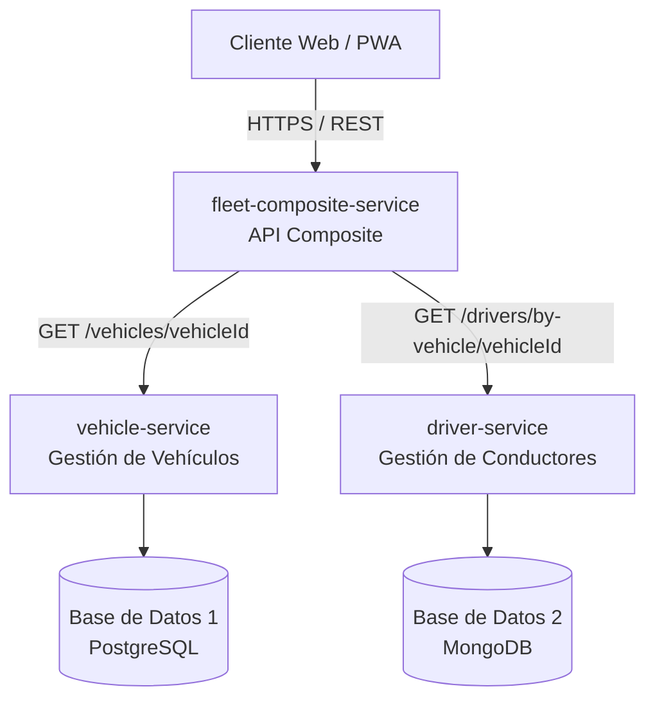
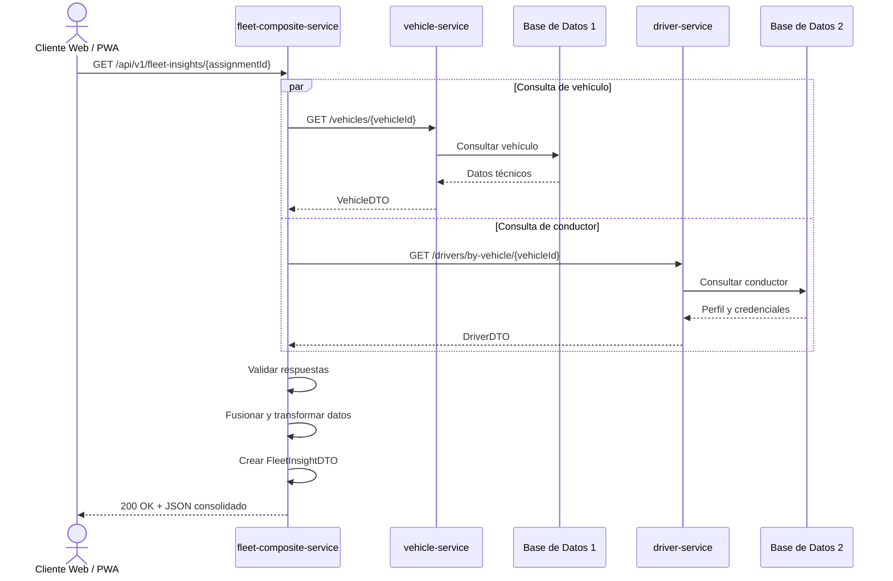
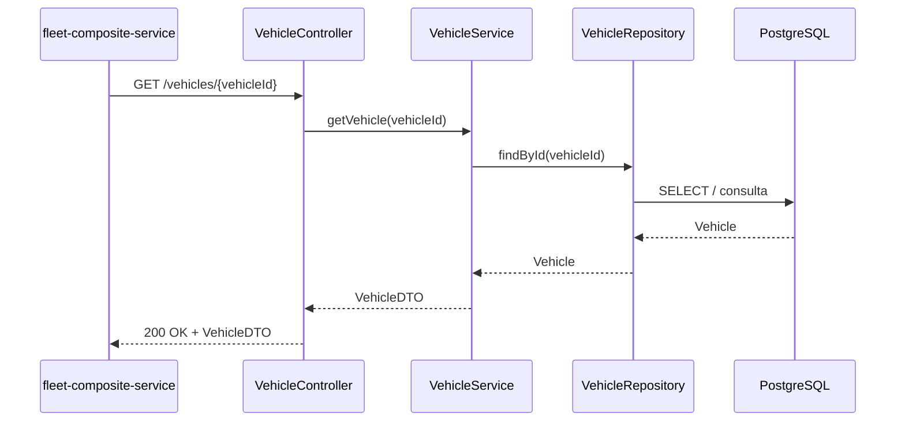
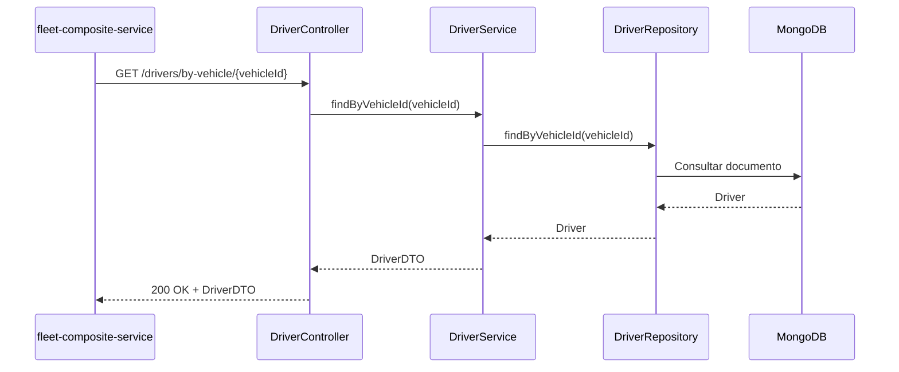

# Sistema de Trazabilidad y Perfil de Flota con API Composite

**Modalidad:** Por equipo  
**Tecnología principal:** Spring Boot  
**Arquitectura:** Microservicios + API Composite  
**Comunicación:** HTTPS / REST  
**Patrón de persistencia:** Database-per-Service

---

## 1. Contexto del Negocio y Objetivo

En una plataforma de **logística inteligente**, los datos relacionados con la operación de los vehículos y la administración de los conductores se encuentran separados debido a criterios de dominio, normalización y responsabilidad.

Por un lado, se encuentran los **datos operacionales de los vehículos**, tales como:

- Telemetría.
- Estado mecánico.
- Estado del motor.
- Nivel de batería o combustible.
- Última ubicación registrada.
- Historial de mantenimientos.

Por otro lado, se encuentran los **datos administrativos relacionados con los conductores**, por ejemplo:

- Perfil del conductor.
- Licencias de conducir.
- Certificaciones.
- Calificaciones de desempeño.
- Credenciales.
- Información relacionada con seguridad.
- Datos asociados con la empresa contratista.

Estos datos deben residir en **tablas, colecciones o bases de datos independientes**, respetando la separación de responsabilidades propia de una arquitectura basada en microservicios.

### Objetivo general

El objetivo del proyecto es construir una arquitectura en la cual un **microservicio compuesto o API Composite** reciba las solicitudes provenientes de una interfaz web o PWA, consulte a diferentes microservicios especializados y entregue una respuesta consolidada.

El API Composite deberá:

1. Recibir una petición desde el cliente web.
2. Invocar a dos microservicios especializados.
3. Ejecutar las consultas de forma concurrente, preferentemente mediante programación reactiva.
4. Obtener la información de las bases de datos independientes.
5. Unificar la información recibida.
6. Fusionar los datos relacionados.
7. Limpiar o transformar los datos cuando sea necesario.
8. Construir un DTO consolidado.
9. Retornar al cliente un único contrato de API enriquecido.

---

## 2. Arquitectura de Microservicios

El sistema estará compuesto por **tres microservicios independientes desarrollados con Spring Boot**.

```text
                     [ Cliente Web / PWA ]
                              │
                         HTTPS / REST
                              │
                              ▼
          ┌─────────────────────────────────────────┐
          │      fleet-composite-service            │
          │       API Composite / Agregador         │
          │                                         │
          │  GET /api/v1/fleet-insights/{id}       │
          └──────────────┬──────────────┬───────────┘
                         │              │
               REST / WebClient   REST / WebClient
                         │              │
                         ▼              ▼
          ┌────────────────────┐  ┌────────────────────┐
          │  vehicle-service   │  │   driver-service   │
          │                    │  │                    │
          │ Gestión de         │  │ Gestión de         │
          │ Vehículos          │  │ Conductores        │
          └─────────┬──────────┘  └─────────┬──────────┘
                    │                       │
                    ▼                       ▼
          ┌────────────────────┐  ┌────────────────────┐
          │   Base de Datos 1  │  │   Base de Datos 2  │
          │                    │  │                    │
          │ PostgreSQL /       │  │ PostgreSQL /       │
          │ MongoDB            │  │ MongoDB            │
          └────────────────────┘  └────────────────────┘
```

### Flujo general

```text
Cliente Web
    │
    │ GET /api/v1/fleet-insights/{assignmentId}
    ▼
fleet-composite-service
    │
    ├──────────── GET /vehicles/{vehicleId} ────────────► vehicle-service
    │                                                       │
    │                                                       ▼
    │                                                 Base de Datos 1
    │
    └──── GET /drivers/by-vehicle/{vehicleId} ──────────► driver-service
                                                            │
                                                            ▼
                                                      Base de Datos 2

fleet-composite-service
    │
    │ Fusiona ambas respuestas
    │
    ▼
FleetInsightDTO
    │
    ▼
Cliente Web / PWA
```

---

# 3. Microservicios del Sistema

## 3.1. `vehicle-service` Jorge

### Microservicio A: Gestión de Vehículos

### Responsabilidad

Administrar toda la información técnica de los vehículos.

Entre sus responsabilidades se incluyen:

- Estado del motor.
- Estado de batería o combustible.
- Última ubicación registrada.
- Información de telemetría.
- Información técnica del vehículo. (todo: explicar qué es lo que abarca este punto)
- Historial de mantenimientos.
- Estado operativo del vehículo. (todo: explicar qué es lo que abarca este punto)

### Base de datos

El microservicio deberá utilizar una base de datos independiente denominada conceptualmente:

```text
vehicle-service-db
```

Nombre de base de datos puede cambiar

Esta base se implementará utilizando:

- MongoDB.

### Información almacenada

Ejemplo de información:

```text
Vehicle
├── id
├── plate
├── model
├── manufacturer
├── year
├── engineStatus
├── batteryStatusPercentage
├── lastLatitude
├── lastLongitude
├── lastTelemetryDate
└── operationalStatus
```

### Operaciones CRUD mínimas

El microservicio deberá administrar el catálogo de vehículos.

#### Consultar vehículo

```http
GET /vehicles/{id}
```

Ejemplo:

```http
GET /vehicles/veh-001
```

#### Consultar varios vehículos

```http
GET /vehicles/
```

Ejemplo:

```http
GET /vehicles/
```

#### Crear vehículo

```http
POST /vehicles
```

Ejemplo de solicitud:

```json
{
  "plate": "ABC-1234",
  "model": "EcoTruck EV",
  "manufacturer": "EcoMotors",
  "year": 2026,
  "batteryStatusPercentage": 84.5,
  "engineStatus": "ACTIVE"
}
```

### Endpoint principal consumido por el Composite

```http
GET /vehicles/{vehicleId}
```

Ejemplo de respuesta:

```json
{
  "id": "veh-001",
  "plate": "ABC-1234",
  "model": "EcoTruck EV",
  "batteryStatusPercentage": 84.5
}
```

```http
GET /vehicles/
```

Ejemplo de respuesta:

```json
[
  {
    "id": "veh-001",
    "plate": "ABC-1234",
    "model": "EcoTruck EV",
    "batteryStatusPercentage": 84.5
  }
  {
    "id": "veh-001",
    "plate": "ABC-1234",
    "model": "EcoTruck EV",
    "batteryStatusPercentage": 84.5
  }
]
```

---

## 3.2. `driver-service` Diego

### Microservicio B: Gestión de Conductores

### Responsabilidad

Administrar toda la información relacionada con los operadores o conductores de los vehículos.

Entre sus responsabilidades se incluyen:

- Perfil del conductor.
- Licencias de conducir.
- Vigencia de las licencias.
- Categorías de licencia.
- Certificaciones.
- Certificaciones de seguridad.
- Calificaciones de desempeño.
- Credenciales.
- Bitácoras o eventos relacionados con el conductor.
- Asociación entre conductor y vehículo.

### Base de datos

El microservicio deberá utilizar una base de datos independiente denominada conceptualmente:

```text
Base de Datos 2
```

Puede implementarse utilizando:

- PostgreSQL.
- MongoDB.

Para la implementación recomendada puede utilizarse **MongoDB**, debido a que permite manejar atributos dinámicos, certificaciones y bitácoras de eventos de manera flexible.

### Información almacenada

Ejemplo conceptual:

```text
Driver
├── id
├── fullName
├── vehicleId
├── licenseNumber
├── licenseCategory
├── licenseExpirationDate
├── safetyScore
├── certifications[]
└── status
```

### Operaciones CRUD mínimas

#### Consultar conductor

```http
GET /drivers/{id}
```

Ejemplo:

```http
GET /drivers/drv-552
```

#### Crear conductor

```http
POST /drivers
```

Ejemplo:

```json
{
  "fullName": "Elena Vance",
  "vehicleId": "veh-001",
  "licenseCategory": "Commercial-A",
  "safetyScore": 98.2,
  "certifications": ["Defensive Driving", "Hazardous Materials Safety"]
}
```

### Consulta por vehículo

El API Composite deberá poder obtener al conductor actualmente asociado con determinado vehículo.

```http
GET /drivers/by-vehicle/{vehicleId}
```

Ejemplo:

```http
GET /drivers/by-vehicle/veh-001
```

Ejemplo de respuesta:

```json
{
  "id": "drv-552",
  "fullName": "Elena Vance",
  "vehicleId": "veh-001",
  "licenseCategory": "Commercial-A",
  "safetyScore": 98.2
}
```

---

## 3.3. `fleet-composite-service`

### Microservicio C: API Composite

### Responsabilidad

El `fleet-composite-service` deberá actuar como **orquestador y agregador de información**.

Será el punto de entrada utilizado por la aplicación web o PWA para consultar información enriquecida sobre una asignación, vehículo y conductor.

Cuando reciba una consulta deberá:

1. Recibir el identificador de la asignación o vehículo.
2. Identificar el vehículo relacionado.
3. Consultar al `vehicle-service`.
4. Consultar al `driver-service`.
5. Ejecutar ambas llamadas HTTP de forma asíncrona o concurrente.
6. Esperar las respuestas.
7. Validar la información obtenida.
8. Fusionar los datos.
9. Eliminar información innecesaria.
10. Transformar los datos al formato definido por el contrato externo.
11. Crear un DTO enriquecido.
12. Agregar un timestamp de composición.
13. Retornar el resultado al cliente.

### Persistencia

El `fleet-composite-service` **no deberá contar con una base de datos propia**.

Será un microservicio:

```text
Stateless
```

Su responsabilidad se limita a:

- Orquestación.
- Integración.
- Transformación.
- Consolidación.
- Aplicación de reglas de negocio.
- Exposición de una API de alto nivel.

---

# 4. Contrato de la API Composite

## Endpoint consolidado

Cuando el cliente web necesite consultar el resumen operativo de una asignación deberá utilizar:

```http
GET /api/v1/fleet-insights/{assignmentId}
```

Opcionalmente, el sistema podrá implementar una consulta cruzada utilizando directamente el identificador del vehículo.

Ejemplo:

```http
GET /api/v1/fleet-insights/asg-9982-x
```

---

# 5. Proceso Interno del API Composite

El flujo esperado será el siguiente:

```text
1. Cliente Web / PWA
        │
        │ GET /api/v1/fleet-insights/{assignmentId}
        ▼
2. fleet-composite-service
        │
        ├── Obtiene vehicleId asociado
        │
        ├── GET /vehicles/{vehicleId}
        │
        └── GET /drivers/by-vehicle/{vehicleId}
                │
                ▼
3. Las dos solicitudes se ejecutan en paralelo
                │
                ▼
4. Se reciben ambas respuestas
                │
                ▼
5. Se validan los resultados
                │
                ▼
6. Se fusionan los datos
                │
                ▼
7. Se construye FleetInsightDTO
                │
                ▼
8. Se agrega compositeTimestamp
                │
                ▼
9. Se retorna el JSON consolidado
```

---

# 6. Respuesta Consolidada

El cliente web deberá recibir un único objeto JSON con la información relevante del vehículo y del conductor.

## Ejemplo

```json
{
  "assignmentId": "asg-9982-x",
  "vehicle": {
    "id": "veh-001",
    "plate": "ABC-1234",
    "model": "EcoTruck EV",
    "batteryStatusPercentage": 84.5
  },
  "driver": {
    "id": "drv-552",
    "fullName": "Elena Vance",
    "licenseCategory": "Commercial-A",
    "safetyScore": 98.2
  },
  "compositeTimestamp": "2026-10-14T15:30:00Z"
}
```

---

# 7. DTO Consolidado

El API Composite deberá definir un DTO encargado de representar la respuesta externa.

Ejemplo conceptual:

```java
public record FleetInsightDTO(
    String assignmentId,
    VehicleSummaryDTO vehicle,
    DriverSummaryDTO driver,
    Instant compositeTimestamp
) {}
```

DTO correspondiente al vehículo:

```java
public record VehicleSummaryDTO(
    String id,
    String plate,
    String model,
    Double batteryStatusPercentage
) {}
```

DTO correspondiente al conductor:

```java
public record DriverSummaryDTO(
    String id,
    String fullName,
    String licenseCategory,
    Double safetyScore
) {}
```

> Los DTO anteriores representan una posible implementación. El equipo puede utilizar clases tradicionales, Lombok o Java Records.

---

# 8. Comunicación entre Microservicios

La comunicación deberá realizarse utilizando:

```text
HTTP / REST
```

Para las llamadas desde el `fleet-composite-service` se recomienda utilizar:

```text
Spring WebClient
```

Ejemplo conceptual:

```java
webClient
    .get()
    .uri("/vehicles/{id}", vehicleId)
    .retrieve()
    .bodyToMono(VehicleDTO.class);
```

Para el conductor:

```java
webClient
    .get()
    .uri("/drivers/by-vehicle/{id}", vehicleId)
    .retrieve()
    .bodyToMono(DriverDTO.class);
```

---

# 9. Concurrencia y Programación Reactiva

Uno de los principales retos técnicos consiste en evitar que las llamadas hacia los microservicios se realicen innecesariamente de forma secuencial.

## Ejecución secuencial

Un flujo secuencial sería:

```text
Consultar vehicle-service
        │
        ▼
Esperar respuesta
        │
        ▼
Consultar driver-service
        │
        ▼
Esperar respuesta
        │
        ▼
Fusionar
```

En este escenario, aproximadamente:

```text
Tiempo total ≈ Tiempo Vehicle + Tiempo Driver
```

---

## Ejecución concurrente

La solución deberá privilegiar un flujo como el siguiente:

```text
                   ┌──► vehicle-service ───► VehicleDTO
Composite Service ─┤
                   └──► driver-service ────► DriverDTO
                              │
                              ▼
                         Mono.zip(...)
                              │
                              ▼
                       FleetInsightDTO
```

Aproximadamente:

```text
Tiempo total ≈ max(Tiempo Vehicle, Tiempo Driver)
```

Para ello se podrá utilizar programación reactiva mediante:

```text
Spring WebFlux
WebClient
Mono
Mono.zip(...)
```

Ejemplo conceptual:

```java
Mono<VehicleDTO> vehicleMono =
        vehicleClient.getVehicle(vehicleId);

Mono<DriverDTO> driverMono =
        driverClient.getDriverByVehicle(vehicleId);

return Mono.zip(vehicleMono, driverMono)
        .map(tuple -> new FleetInsightDTO(
                assignmentId,
                mapVehicle(tuple.getT1()),
                mapDriver(tuple.getT2()),
                Instant.now()
        ));
```

---

# 10. Persistencia Híbrida

Como característica adicional, el sistema puede utilizar diferentes tecnologías de almacenamiento.

## `vehicle-service`

Tecnología sugerida:

```text
PostgreSQL
```

Justificación:

- Relaciones bien definidas.
- Integridad referencial.
- Datos altamente estructurados.
- Transacciones.
- Restricciones y claves foráneas.

Ejemplos de entidades:

```text
vehicles
telemetry
maintenance
```

---

## `driver-service`

Tecnología sugerida:

```text
MongoDB
```

Justificación:

- Flexibilidad en los atributos.
- Certificaciones variables.
- Bitácoras.
- Eventos.
- Documentos con estructuras dinámicas.
- Fácil evolución del esquema.

Ejemplos de colecciones:

```text
drivers
driver_credentials
driver_events
```

---

# 11. Principio Database-per-Service

Cada microservicio será propietario exclusivo de su información.

```text
vehicle-service
      │
      └────► vehicle_db

driver-service
      │
      └────► driver_db

fleet-composite-service
      │
      └────► Sin base de datos
```

## Regla importante

El `fleet-composite-service` **no deberá consultar directamente las tablas o colecciones pertenecientes a otros microservicios**.

### Incorrecto

```text
fleet-composite-service
        │
        ├────► vehicle_db
        └────► driver_db
```

### Correcto

```text
fleet-composite-service
        │
        ├────► vehicle-service ───► vehicle_db
        │
        └────► driver-service ────► driver_db
```

De esta manera, cada servicio conserva el control y encapsulamiento de sus propios datos.

---

# 12. Diagrama de Componentes

Cada microservicio deberá incluir su correspondiente **diagrama de componentes**.

Un diagrama global de referencia puede representarse mediante Mermaid.



---

# 13. Diagrama de Secuencia del API Composite



---

# 14. Diagrama de Secuencia de `vehicle-service`



---

# 15. Diagrama de Secuencia de `driver-service`



---

# 16. Arquitectura Interna Sugerida

Cada microservicio podrá utilizar una estructura similar a:

```text
src/
└── main/
    ├── java/
    │   └── com/example/service/
    │       ├── controller/
    │       ├── service/
    │       ├── repository/
    │       ├── model/
    │       ├── dto/
    │       ├── mapper/
    │       ├── config/
    │       ├── exception/
    │       └── ServiceApplication.java
    │
    └── resources/
        ├── application.yml
        └── application.properties
```

En el caso del `fleet-composite-service`, también puede agregarse:

```text
client/
```

Ejemplo:

```text
fleet-composite-service/
└── src/main/java/
    └── com/example/fleetcomposite/
        ├── controller/
        │   └── FleetInsightController.java
        ├── service/
        │   └── FleetCompositeService.java
        ├── client/
        │   ├── VehicleClient.java
        │   └── DriverClient.java
        ├── dto/
        │   ├── FleetInsightDTO.java
        │   ├── VehicleDTO.java
        │   └── DriverDTO.java
        ├── config/
        │   └── WebClientConfig.java
        ├── exception/
        └── FleetCompositeApplication.java
```

---

# 17. Manejo de Errores

Los microservicios deberán manejar correctamente errores como:

- Vehículo inexistente.
- Conductor inexistente.
- Asignación inexistente.
- Servicio temporalmente no disponible.
- Timeout.
- Errores de comunicación HTTP.
- Datos inválidos.
- Errores de persistencia.

Ejemplo de respuesta de error:

```json
{
  "timestamp": "2026-10-14T15:30:00Z",
  "status": 404,
  "error": "Not Found",
  "message": "Vehicle veh-001 was not found",
  "path": "/vehicles/veh-001"
}
```

El API Composite deberá evitar exponer innecesariamente detalles internos de implementación.

---

# 18. Códigos HTTP Esperados

| Código                      | Significado                                          |
| --------------------------- | ---------------------------------------------------- |
| `200 OK`                    | Consulta procesada correctamente                     |
| `201 Created`               | Recurso creado correctamente                         |
| `400 Bad Request`           | La solicitud contiene datos inválidos                |
| `404 Not Found`             | El recurso solicitado no existe                      |
| `409 Conflict`              | Existe un conflicto con el estado actual del recurso |
| `500 Internal Server Error` | Error interno                                        |
| `502 Bad Gateway`           | Error comunicándose con un microservicio             |
| `503 Service Unavailable`   | Microservicio temporalmente no disponible            |
| `504 Gateway Timeout`       | Un microservicio excedió el tiempo permitido         |

---

# 19. Requisitos Técnicos

La solución deberá utilizar principalmente:

- Java.
- Spring Boot.
- Spring Web.
- Spring WebFlux.
- WebClient.
- Spring Data JPA para PostgreSQL, en caso de utilizarlo.
- Spring Data MongoDB para MongoDB, en caso de utilizarlo.
- Maven o Gradle.
- REST.
- JSON.

Opcionalmente pueden utilizarse:

- Lombok.
- MapStruct.
- Docker.
- Docker Compose.
- OpenAPI / Swagger.
- Spring Boot Actuator.
- Bean Validation.
- Resilience4j.
- JUnit 5.
- Mockito.
- Testcontainers.

---

# 20. Características Técnicas a Desarrollar

## 20.1. CRUD

Los microservicios `vehicle-service` y `driver-service` deberán implementar operaciones CRUD sobre sus respectivos dominios.

---

## 20.2. Separación de responsabilidades

Cada servicio deberá administrar exclusivamente su dominio y su propia persistencia.

---

## 20.3. API Composite

El `fleet-composite-service` deberá integrar información proveniente de ambos servicios.

---

## 20.4. Programación asíncrona

Las consultas independientes deberán ejecutarse de forma concurrente utilizando programación reactiva.

---

## 20.5. Transformación de datos

No será obligatorio retornar al usuario exactamente el mismo DTO utilizado internamente por los microservicios.

El Composite deberá crear un contrato específico para las necesidades de la interfaz.

---

## 20.6. Persistencia híbrida

Opcionalmente podrá utilizarse:

```text
vehicle-service → PostgreSQL
driver-service  → MongoDB
```

---

## 20.7. Stateless Composite

El API Composite no deberá almacenar datos propios de vehículos o conductores.

---

# 21. Endpoints Mínimos

## `vehicle-service`

| Método   | Endpoint         | Descripción                 |
| -------- | ---------------- | --------------------------- |
| `GET`    | `/vehicles`      | Obtener todos los vehículos |
| `GET`    | `/vehicles/{id}` | Obtener un vehículo         |
| `POST`   | `/vehicles`      | Crear un vehículo           |
| `PUT`    | `/vehicles/{id}` | Actualizar un vehículo      |
| `DELETE` | `/vehicles/{id}` | Eliminar un vehículo        |

---

## `driver-service`

| Método   | Endpoint                          | Descripción                    |
| -------- | --------------------------------- | ------------------------------ |
| `GET`    | `/drivers`                        | Obtener todos los conductores  |
| `GET`    | `/drivers/{id}`                   | Obtener un conductor           |
| `GET`    | `/drivers/by-vehicle/{vehicleId}` | Obtener conductor por vehículo |
| `POST`   | `/drivers`                        | Crear un conductor             |
| `PUT`    | `/drivers/{id}`                   | Actualizar un conductor        |
| `DELETE` | `/drivers/{id}`                   | Eliminar un conductor          |

---

## `fleet-composite-service`

| Método | Endpoint                                     | Descripción                                         |
| ------ | -------------------------------------------- | --------------------------------------------------- |
| `GET`  | `/api/v1/fleet-insights/{assignmentId}`      | Obtener información consolidada de una asignación   |
| `GET`  | `/api/v1/fleet-insights/vehicle/{vehicleId}` | Consulta consolidada directa por vehículo, opcional |

---

# 22. Repositorios

El proyecto deberá estar organizado en repositorios independientes.

Como mínimo:

```text
vehicle-service/
driver-service/
fleet-composite-service/
```

Cada repositorio deberá contener:

```text
README.md
pom.xml o build.gradle
src/
diagramas/
Dockerfile             # Opcional
docker-compose.yml     # Opcional según organización
```

---

# 23. README de Cada Microservicio

Cada repositorio deberá incluir su propio archivo:

```text
README.md
```

El README deberá documentar como mínimo:

1. Nombre del microservicio.
2. Objetivo.
3. Responsabilidad.
4. Tecnologías utilizadas.
5. Arquitectura interna.
6. Modelo de datos.
7. Configuración.
8. Variables de entorno.
9. Cómo ejecutar el proyecto.
10. Endpoints disponibles.
11. Ejemplos de request y response.
12. Diagrama de componentes.
13. Diagrama de secuencia.
14. Dependencias con otros servicios.
15. Base de datos utilizada.

---

# 24. Diagramas Obligatorios

**Cada microservicio deberá integrar sus propios diagramas.**

Como mínimo deberán incluirse:

- Diagrama de componentes.
- Diagrama de secuencia.

Por lo tanto, deberán existir al menos:

```text
vehicle-service
├── Diagrama de componentes
└── Diagrama de secuencia

driver-service
├── Diagrama de componentes
└── Diagrama de secuencia

fleet-composite-service
├── Diagrama de componentes
└── Diagrama de secuencia
```

Los diagramas pueden realizarse utilizando:

- Mermaid.
- PlantUML.
- Draw.io.
- Lucidchart.
- UML.
- Herramientas equivalentes.

Se recomienda integrar Mermaid directamente en los archivos Markdown para facilitar su mantenimiento dentro del repositorio.

---

# 25. Pruebas

Se recomienda incluir pruebas para los tres microservicios.

## Pruebas unitarias

Herramientas sugeridas:

```text
JUnit 5
Mockito
```

Casos mínimos recomendados:

- Obtener vehículo existente.
- Vehículo inexistente.
- Crear vehículo.
- Obtener conductor existente.
- Conductor inexistente.
- Buscar conductor por vehículo.
- Composición correcta de información.
- Fallo de `vehicle-service`.
- Fallo de `driver-service`.

---

## Pruebas de integración

Pueden utilizarse:

```text
Spring Boot Test
WebTestClient
MockWebServer
WireMock
Testcontainers
```

El Composite deberá comprobar que es capaz de integrar correctamente las respuestas provenientes de los otros dos servicios.

---

# 26. Contenedores

Como característica recomendada, cada microservicio puede incluir un archivo:

```text
Dockerfile
```

Y el ecosistema completo podrá levantarse mediante:

```text
docker-compose.yml
```

Ejemplo conceptual:

```text
docker-compose
│
├── vehicle-service
├── vehicle-postgres
├── driver-service
├── driver-mongodb
└── fleet-composite-service
```

---

# 27. Documentación de la API

Se recomienda documentar los endpoints mediante:

```text
OpenAPI / Swagger
```

Dependencia posible:

```xml
<dependency>
    <groupId>org.springdoc</groupId>
    <artifactId>springdoc-openapi-starter-webmvc-ui</artifactId>
</dependency>
```

En proyectos completamente reactivos deberá utilizarse la variante correspondiente a WebFlux.

---

# 28. Recomendaciones de Resiliencia

Como funcionalidad adicional puede implementarse:

```text
Resilience4j
```

Para incorporar patrones como:

- Timeout.
- Retry.
- Circuit Breaker.
- Fallback.

Ejemplo conceptual:

```text
Cliente
   │
   ▼
Composite
   │
   ├── Circuit Breaker ──► vehicle-service
   │
   └── Circuit Breaker ──► driver-service
```

---

# 29. Criterios Funcionales de Aceptación

El proyecto se considerará funcional cuando:

- [ ] `vehicle-service` permita administrar vehículos.
- [ ] `driver-service` permita administrar conductores.
- [ ] Cada microservicio tenga su propia base de datos.
- [ ] Ningún servicio acceda directamente a la base de datos de otro.
- [ ] `fleet-composite-service` no tenga persistencia propia.
- [ ] El Composite pueda consultar al `vehicle-service`.
- [ ] El Composite pueda consultar al `driver-service`.
- [ ] Ambas consultas puedan ejecutarse concurrentemente.
- [ ] La información pueda fusionarse correctamente.
- [ ] El cliente reciba un único JSON consolidado.
- [ ] Los errores sean manejados apropiadamente.
- [ ] Los endpoints REST se encuentren documentados.
- [ ] Cada microservicio cuente con su diagrama de componentes.
- [ ] Cada microservicio cuente con su diagrama de secuencia.
- [ ] Cada repositorio incluya un `README.md`.
- [ ] El código esté disponible en los repositorios correspondientes.

---

# 30. Entregables

Cada equipo deberá entregar los siguientes elementos.

## 30.1. Repositorios

Tres repositorios independientes:

```text
1. vehicle-service
2. driver-service
3. fleet-composite-service
```

---

## 30.2. Código fuente

Cada repositorio deberá contener el código fuente completo y ejecutable del microservicio correspondiente.

---

## 30.3. Persistencia

Deberán incluirse los scripts, configuraciones o instrucciones necesarias para crear y utilizar las bases de datos.

---

## 30.4. Diagramas

**Cada microservicio deberá integrar sus diagramas de secuencia y componentes.**

---

## 30.5. Documentación

Cada repositorio deberá incluir:

```text
README.md
```

con las instrucciones necesarias para configurar, ejecutar y probar el servicio.

---

## 30.6. Evidencia de integración

Se deberá demostrar una consulta funcional al endpoint consolidado:

```http
GET /api/v1/fleet-insights/{assignmentId}
```

cuya respuesta combine correctamente información proveniente del:

```text
vehicle-service
+
driver-service
```

---

# 31. Resultado Esperado

El resultado final deberá representar una arquitectura similar a la siguiente:

```text
                         CLIENTE WEB / PWA
                                │
                                │
                           HTTPS / REST
                                │
                                ▼
                  ┌──────────────────────────┐
                  │ fleet-composite-service  │
                  │                          │
                  │ Orquestación             │
                  │ Transformación           │
                  │ Agregación               │
                  └────────────┬─────────────┘
                               │
                ┌──────────────┴──────────────┐
                │                             │
                ▼                             ▼
       ┌─────────────────┐           ┌─────────────────┐
       │ vehicle-service │           │ driver-service  │
       └────────┬────────┘           └────────┬────────┘
                │                             │
                ▼                             ▼
       ┌─────────────────┐           ┌─────────────────┐
       │   PostgreSQL    │           │     MongoDB     │
       │   vehicle_db    │           │    driver_db    │
       └─────────────────┘           └─────────────────┘
```

El cliente deberá interactuar únicamente con el contrato de alto nivel proporcionado por el `fleet-composite-service`, evitando tener que conocer la estructura interna o las bases de datos de los microservicios especializados.

---

# 32. Resumen del Proyecto

El proyecto implementará una solución basada en el patrón **API Composite**, compuesta por tres microservicios:

```text
vehicle-service
        +
driver-service
        ↓
fleet-composite-service
        ↓
Cliente Web / PWA
```

Los servicios especializados serán responsables de sus propios dominios y bases de datos, mientras que el API Composite se encargará de consultar ambos servicios, procesar sus respuestas y entregar una representación consolidada.

La solución deberá demostrar conceptos de:

- Arquitectura de microservicios.
- API Composite Pattern.
- REST.
- Spring Boot.
- Spring WebFlux.
- WebClient.
- Programación reactiva.
- Programación asíncrona.
- Concurrencia.
- DTOs.
- Persistencia independiente.
- Database-per-Service.
- Persistencia híbrida.
- Integración entre servicios.
- Manejo de errores.
- Documentación de APIs.
- Diagramas de componentes.
- Diagramas de secuencia.
- Pruebas unitarias y de integración.

El objetivo principal es ofrecer a la aplicación cliente una **visión única, enriquecida y consolidada de la flota**, sin comprometer la independencia, encapsulamiento y responsabilidad de cada microservicio.
